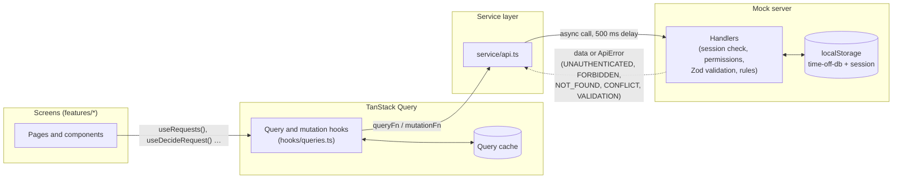
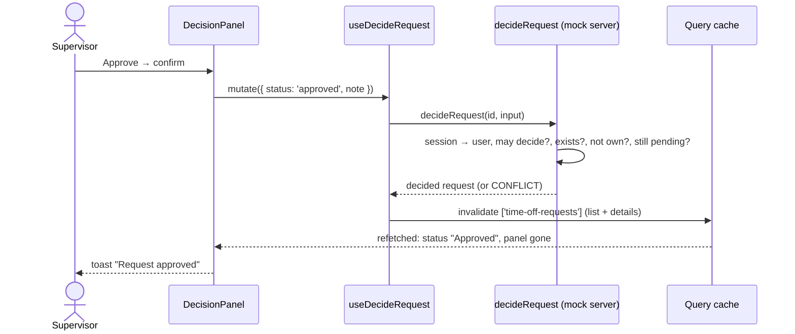

# Architecture Overview

This document explains how the app is organised and how data flows through it.

## Contents

- [Approach](#approach)
- [Folder structure](#folder-structure)
- [Routes and access](#routes-and-access)
- [Data flow](#data-flow)
- [Mock server](#mock-server)
- [Screens](#screens)
- [Cross-cutting concerns](#cross-cutting-concerns)

## Approach

- **Feature-based folders:** each feature owns its pages, components, query hooks, API calls and rules.
- **One direction of imports:** `app` → `features` → `shared`. Features don't import from each other; `shared` never imports from a feature; only each feature's `service/api.ts` talks to the mock server.
- **One set of screens for both roles:** the request list and details are shared; a permissions config decides what each role sees and can do.

## Folder structure

```text
src/
├── main.tsx              entry point
├── app/                  providers, query client, route table, route guards, not-found page
├── features/
│   ├── auth/             login page, demo users, demo data controls
│   └── requests/         list, details (+ decision panel), new request form
│       ├── components/
│       ├── hooks/        TanStack Query hooks (queries and mutations)
│       ├── rules/        pure logic (grouping into upcoming / past)
│       └── service/      api.ts: the only file that calls the mock server
├── shared/
│   ├── api/              ApiError (typed error codes)
│   ├── components/       AppPage layout, EmptyState, ErrorState, StatusBadge, RoleLabel
│   ├── schema/           newRequestSchema (Zod), used by the form and the server
│   ├── session/          current user, logout, header account menu
│   ├── types/            User, TimeOffRequest, labels
│   ├── utils/            dates (working days, formatting)
│   └── permissions.ts    roles → permissions, can(user, permission)
├── mock-server/          the pretend backend: handlers, seed data, storage, session
├── test/                 renderWithProviders helper
└── theme/                global stylesheet and Ionic colour variables (light and dark)
```

## Routes and access

| Route           | Screen          | Access                                                                    |
| --------------- | --------------- | ------------------------------------------------------------------------- |
| `/login`        | Log in          | Public; logged-in users are sent to `/requests`                           |
| `/requests`     | Request list    | Logged in                                                                 |
| `/requests/new` | New request     | Logged in + `request:create` (employees)                                  |
| `/requests/:id` | Request details | Logged in; the mock server answers "not found" for someone else's request |
| `/`             | → `/login`      |                                                                           |
| anything else   | Page not found  |                                                                           |

- Routes live in `IonRouterOutlet` (Ionic's page stack: native transitions, swipe back, previous pages stay mounted).
- Guards: `RequireAuth`, `RedirectIfLoggedIn`, `RequirePermission`.
- **Access is checked in three places from one permissions config:** route guards, components (show or hide actions) and the mock server (refuses anyway). The front end hides; the server enforces.

## Data flow



**Example: a supervisor approves a request**



- **TanStack Query owns server data:** caching, loading and error states, invalidation after writes. There's no React Context; **the session is server state** too (`useCurrentUser` asks the mock server "who am I?", like `GET /me`).
- **Query keys:** `['time-off-requests']` for the list, `['time-off-requests', id]` for details, so one invalidation refreshes both.
- **Defaults:** data stays fresh for 5 minutes (instant back navigation); refetch whenever the window gets focus; reads retry once, except an `ApiError` (the server's real answer: retrying can't change it); writes never retry.
- **Ionic's page stack** keeps previous pages mounted, so freshness comes from invalidation and focus refetches, not from remounting.

## Mock server

- Plays the backend: async functions with a 500 ms delay, data in localStorage, seeded with sample requests on first run.
- **Identifies the caller from the session**, never from data the client sends.
- Checks permissions, ownership and business rules; validates input with the **same Zod schema as the form**; returns typed errors.
- Rules it enforces: employees see only their own requests (someone else's is "not found", so its existence isn't revealed); only supervisors decide; nobody decides their own request; a decision is final (`CONFLICT` on a second one); new requests can't overlap the employee's pending or approved requests (`CONFLICT`).
- **Demo data controls** on the login page: "Reset sample data" and "Start empty" (users are always kept).
- With a real backend, the mock server is deleted and each feature's `service/api.ts` calls `fetch` instead; nothing else changes.

## Screens

- **Login:** demo users to tap (two employees, one supervisor), role shown in colour; demo data controls.
- **Request list:** Upcoming / Past switch with counts. Employees see their own requests and a "Request time off" button; the supervisor sees everyone's, with names.
- **Request details:** status, type, working days, dates, note, submitted date; the decision (who, when, note) once decided; for the supervisor on a pending request, the decision panel (note, Approve, Reject, both confirmed).
- **New request:** type, from/to dates (native pickers), optional note; live working-day count; errors under the fields.

## Cross-cutting concerns

| Concern                             | Where it's handled                                                                                                |
| ----------------------------------- | ----------------------------------------------------------------------------------------------------------------- |
| **Loading, empty and error states** | Every screen: skeletons, empty states, errors with "Try again"; "not found" without retry                         |
| **Access control**                  | `permissions.ts`, used by route guards, components and the mock server                                            |
| **Double submits**                  | Buttons and fields disabled while saving; a spinner or "Sending…" in the pressed button; `CONFLICT` on the server |
| **Validation**                      | One Zod schema (`shared/schema`), shared by the form and the mock server; overlap checked on the server           |
| **Concurrent changes**              | A second decision gets `CONFLICT`; the page refetches and shows what really happened                              |
| **Dates**                           | Calendar dates stored as `YYYY-MM-DD` (local), moments as ISO (UTC); working days Monday–Friday                   |
| **Accessibility**                   | Ionic components and native elements, labelled fields, status as text, hidden labels for icon rows, live regions  |
| **Responsive layout**               | Mobile-first; on wide screens a centred 640 px column; iOS and Material modes                                     |
| **Theming**                         | Ionic CSS variables in `theme/`; light and dark follow the system                                                 |
| **Testing**                         | Pure rules, the schema and the mock server with unit tests; pages with React Testing Library                      |
